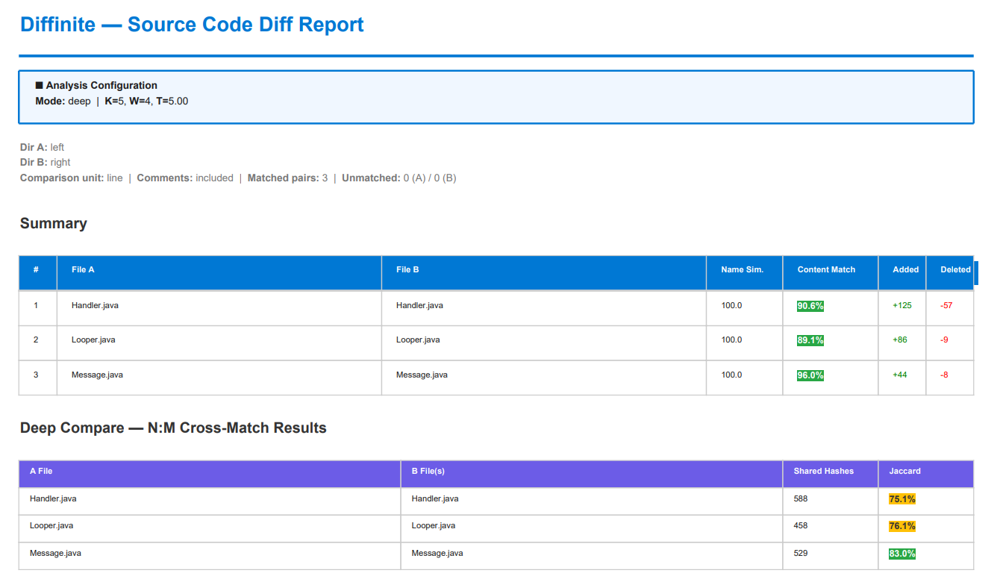
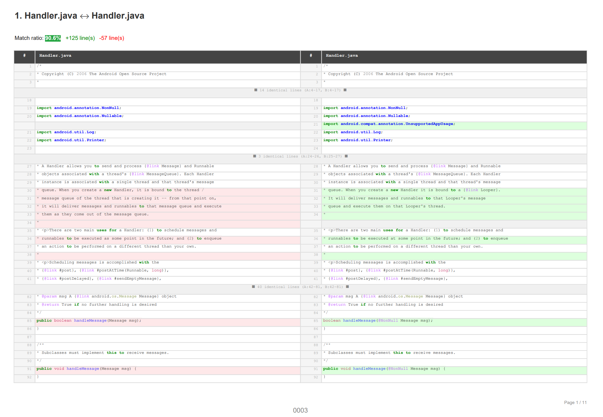

# Diffinite

[](https://pypi.org/project/diffinite/)
[](https://github.com/nash-dir/diffinite/actions/workflows/ci.yml)
[](LICENSE)
[](https://pypi.org/project/diffinite/)

**Forensic source-code comparison tool for IP litigation and code audit.**

Diffinite compares two directories of source code and produces professional PDF/HTML reports with syntax-highlighted side-by-side diffs. It uses [Winnowing fingerprints](https://theory.stanford.edu/~aiken/publications/papers/sigmod03.pdf) (Schleimer et al., 2003 — the algorithm behind [Stanford MOSS](https://theory.stanford.edu/~aiken/moss/)) for N:M cross-matching to detect code reuse across renamed files; for pairs that pass the Jaccard threshold, directional containment (*A in B / B in A*) shows how much of each file was carried over.



> **Design Principle**: Diffinite reports **how similar** and **where similar**. It does not classify the type of copying — that is the expert witness's job.

---

## VS Code Extension

The recommended way to use Diffinite **on Windows** is through the **VS Code extension**, which bundles an embedded Python runtime — no separate Python installation required. On macOS/Linux the extension runs against a system Python (`pip install diffinite`, then set `diffinite.pythonPath`) — see [Platform Support](#platform-support).

### Features
- **Visual directory picker** — Select two directories and configure options via a GUI panel
- **Real-time progress bar** — Live percentage tracking during analysis
- **Rough time estimate** — Scans file sizes upfront and gives an approximate Simple/Deep mode duration (a heuristic, not a measured prediction)
- **Phase 2 estimate scaled by Phase 1 speed** — Rescales the rough Phase 2 estimate using how long Phase 1 actually took
- **Large-file notice** — Non-blocking warning when a same-path file pair is 5 MB or larger; memory protection itself comes from the CLI's `--max-file-size` (default 10 MB)
- **Interactive tree viewer** — Review matched pairs and selectively export
- **One-click PDF/HTML export** — With Bates numbering, page numbers, and filename annotations

### Install from Source

```bash
cd vscode-extension
npm install
npm run compile
# Press F5 in VS Code to launch Extension Development Host
```

---

## CLI Installation

```bash
pip install diffinite
```

Or from source:

```bash
git clone https://github.com/nash-dir/diffinite.git
cd diffinite
pip install -e ".[dev]"
```

**Requirements**: Python ≥ 3.10

**Dependencies**: [RapidFuzz](https://github.com/rapidfuzz/RapidFuzz), [Pygments](https://pygments.org/), [xhtml2pdf](https://github.com/xhtml2pdf/xhtml2pdf), [pypdf](https://github.com/py-pdf/pypdf), [reportlab](https://docs.reportlab.com/), [charset-normalizer](https://github.com/Ousret/charset_normalizer)

---

## Platform Support

| Component | Windows | Linux | macOS |
|-----------|:-------:|:-----:|:-----:|
| **CLI** (`pip install diffinite`) | ✅ supported | ✅ tested in CI | ◯ expected to work (pure Python; not in CI) |
| **VS Code extension** | ✅ bundles an embedded Python runtime; primary tested target | △ via system Python (`pip install diffinite` + `diffinite.pythonPath`); not officially tested | △ same as Linux; not officially tested |

The VS Code extension is published for `win32-x64`, `linux-x64` and `darwin-arm64`, but only the **Windows** package ships the embedded runtime. On macOS/Linux, use the CLI directly, or point the extension at your own interpreter via the `diffinite.pythonPath` setting. The CLI itself is pure Python and platform-independent.

---

## Quick Start

```bash
# Compare two directories → PDF report
diffinite original/ suspect/ -o report.pdf

# With comment stripping and Bates numbering (forensic use)
diffinite original/ suspect/ -o report.pdf \
    --strip-comments --bates-number --page-number --filename

# HTML report (single self-contained file, opens in browser)
diffinite original/ suspect/ --report-html report.html
```

---

## How It Works

Diffinite runs a two-stage pipeline:

### Stage 1: 1:1 File Matching (`simple` mode)

1. **Fuzzy name matching** — Pairs files across `dir_a` and `dir_b` using [RapidFuzz](https://github.com/rapidfuzz/RapidFuzz) string similarity (configurable threshold).
2. **Comment stripping** — Optionally removes comments using a 6-state finite state machine parser supporting 45+ file extensions.
3. **Side-by-side diff** — Computes line-by-line (or word-by-word) diffs using Python's `difflib.SequenceMatcher` with `autojunk=True`, a heuristic that drops high-frequency lines to speed up matching on large files (`SequenceMatcher` itself remains worst-case quadratic).
4. **Report generation** — Renders syntax-highlighted HTML diffs via Pygments, then converts to PDF with xhtml2pdf.

### Stage 2: N:M Cross-Matching (`deep` mode, default)

5. **Winnowing fingerprint extraction** — Extracts position-independent code fingerprints using the Winnowing algorithm (K-gram → rolling hash → window selection).
6. **Inverted index construction** — Builds a hash-to-file mapping for all B-directory fingerprints.
7. **Jaccard similarity computation** — For each A-file, queries the index to find all B-files sharing fingerprints, then computes Jaccard similarity `|A∩B| / |A∪B|`.
8. **Cross-match reporting** — Appends an N:M similarity matrix to the report, showing which files from A are similar to which files in B.

---

## Output Report

### Cover Page

The cover page contains a summary table for each matched file pair:

| Column | Description |
|--------|-------------|
| **File A / File B** | Matched file paths |
| **Name Sim.** | Fuzzy filename similarity score (0–100) |
| **Line match (difflib)** — labelled *Word match* under `--by-word` | `difflib.SequenceMatcher.ratio()` as a percentage — `2 × matched lines ÷ (lines A + lines B)`; with `--by-word` the unit is whitespace-separated words instead of lines. `100%` = identical. difflib's `autojunk` heuristic (on by default) looks only at File B: when File B has fewer than 200 lines (words under `--by-word`), blank and brace-only lines count as matches, so unrelated small files can still score 10–30%; when File B has 200 or more, any line occurring in more than about 1% of File B's lines (typically blanks and `}`) is ignored, so unrelated large files usually score only a few percent (see the negative control under [Benchmarks](#benchmarks)). `--no-autojunk` counts every line at all file sizes. |
| **Added / Deleted** | Number of lines (or words, with `--by-word`) added to or deleted from File A to produce File B. |

Pairs that were not compared by difflib never show a percentage or `+0` / `−0`:

- **SHA-256 only** — a pair that is binary / not decodable as text (with `--binary-handling hash`, the default) or larger than `--max-file-size` shows `Not compared by difflib (<reason>); SHA-256 identical` or `… SHA-256 different` instead of a line-match value, and its +/− columns show `—`. Identical bytes are not reported as `100%`.
- **Error** — a pair that could not be read or decoded (including `--binary-handling error`) shows *Not compared* with the error, its +/− columns show `—`, and the run is marked *incomplete*.
- **Excluded** — with `--binary-handling exclude`, a matched binary pair is not compared and has no row of its own; it is listed by name under *Matched pairs not compared* in the completeness section (see [Completeness Disclosure](#completeness-disclosure)).

A non-identical ratio is never rounded up to `100%`: values below 1 are capped at the largest value the display precision allows (for example `99.99%`).

### Diff Pages

Each matched pair gets a side-by-side diff page with:

- **Green highlight** — Lines present only in File B (additions)
- **Red highlight** — Lines present only in File A (deletions)
- **Yellow highlight** — Lines changed between A and B; in `--by-word` mode the changed words within are further marked (removed words struck through, added words bold)
- **Purple highlight** — Lines moved from this position (`--detect-moved`)
- **Blue highlight** — Lines moved to this position (`--detect-moved`)
- **No highlight** — Identical lines (with configurable context folding)



### Deep Compare Section

When running in `deep` mode (default), the report includes an N:M cross-matching table:

| Column | Description |
|--------|-------------|
| **File A** | Source file from directory A |
| **Matched Files (B)** | All files from directory B that share fingerprints above the Jaccard threshold |
| **Shared Hashes** | Count of Winnowing fingerprints the file pair has in common |
| **Jaccard** | `|A∩B| / |A∪B|` — the fraction of shared Winnowing fingerprints. |

Jaccard similarity is a well-defined set metric. Its interpretation depends on the domain, code size, and language. Diffinite reports the raw value without attaching qualitative labels.

### Completeness Disclosure

Every report (PDF cover, HTML, Markdown, JSON `analysis_status`) states what was *not* analysed, by name, so no input is dropped silently:

| Line | What it lists |
|------|---------------|
| **Collection** | Files or directories that were listed but not collected: symbolic links and Windows link-type reparse points (junctions), non-regular files (FIFOs, sockets, devices), entries whose `stat` failed (reported by errno name, e.g. `EACCES`, so the text is the same on every machine), and on Windows any name ending in `.` or a space (Windows cannot open such a name by its plain path). Without `--allow-partial` the run stops; with it the report is marked *incomplete*. Entries excluded by `--ignore-file` are not failures and are not listed here. |
| **Diff pairs** | `processed / requested`, the number of **failed** pairs (worker failure or read/decode error, each listed with its reason) and the number of pairs **excluded** by `--binary-handling exclude` (each listed by name). Requested = processed + failed + excluded. |
| **Deep files** | `processed / requested`, file or worker failures, files **skipped (binary or not decodable as text)** with the reason, and files **below the k-gram size**, which were read but produce no fingerprints and so cannot appear in the Deep Compare table. |
| **Selection filter** | With `--filter-json`, how many unmatched files of A and B the filtered report leaves out. |
| **Lang-aware fallback** | With `--normalize --lang-aware`, files whose Pygments lexer failed and were tokenized by the built-in regex tier instead. |

A report with any failure is labelled *incomplete*; the counts and names above say which part is missing.

### Page Annotations

| Option | Annotation | Position |
|--------|-----------|----------|
| `--page-number` | `Page 3 / 5` (counted within the current file's diff) | Bottom-right |
| `--file-number` | `File 2 / 12` | Bottom-left |
| `--bates-number` | `TEST-000003-CONF` | Bottom-center |
| `--filename` | `com/example/Foo.java` | Top-right |

---

## CLI Reference

### Positional Arguments

```
dir_a    Path to the original source directory (A)
dir_b    Path to the comparison source directory (B)
```

### Execution Mode

| Option | Default | Description |
|--------|:-------:|-------------|
| `--mode {simple,deep}` | `deep` | `simple` = 1:1 file matching only. `deep` = 1:1 + N:M Winnowing cross-matching. |

### Output Options

| Option | Description |
|--------|-------------|
| `--report-pdf PATH` (alias `-o`) | Generate a merged PDF report. Defaults to `report.pdf` when no `--report-*` flag is given. |
| `--report-html PATH` | Generate standalone HTML report (single file, no external deps) |
| `--report-md PATH` | Generate Markdown summary report |
| `--report-json PATH` | Generate machine-readable JSON report (used by VS Code extension) |
| `--no-merge` | Generate per-file PDF and/or HTML artifacts in `<stem>_files/` instead of a merged document. The tree is an exact current-run evidence set; obsolete merged anchors/sidecars are removed transactionally. A non-empty prior tree is replaced only when its files match the prior integrity manifest, so unrelated user files are never silently deleted. |
| `--preserve-tree` / `--no-preserve-tree` | Preserve directory tree structure in individual output (default: on) |
| `--sort-by {filename,path,similarity,ratio}` | Sort matched pairs in the report. Default: insertion order (no sort). |
| `--sort-order {asc,desc}` | Sort direction (default: `asc`). Only effective with `--sort-by`. |

### PDF Font / CJK Rendering

Korean, Japanese, and Chinese text is rendered correctly in PDF output. By default the built-in xhtml2pdf CJK font (`HYGothic-Medium`) is used as a fallback; for a specific typeface, supply one of the options below. HTML output relies on the browser's native font fallback and needs no configuration.

| Option | Description |
|--------|-------------|
| `--pdf-lang {ko,ja,zh-cn,…}` | Auto-resolve the best OS-installed font for the given language from the built-in `pdf_fonts.json` map (Windows/macOS/Linux paths). |
| `--pdf-font PATH` | Absolute path to a `.ttf`/`.otf` font to embed via `@font-face` as the primary typeface. Takes precedence over `--pdf-lang`. |

> Extend or override language→font mappings by creating `~/.diffinite_fonts.json` (same schema as the built-in map). User entries are merged over the built-ins per language.

### Diff Options

| Option | Default | Description |
|--------|:-------:|-------------|
| `--strip-comments` | off | Strip comments before comparison (6-state FSM parser, 45+ extensions) |
| `--by-word` | off | Compare by word instead of by line |
| `--squash-blanks` | off | Collapse runs of 3+ blank lines. ⚠️ Changes line numbers — not recommended for forensic line-tracing. |
| `--threshold N` | `60` | Fuzzy file-name matching threshold (0–100). Lower = more aggressive matching. |
| `--collapse-identical` | off | Fold unchanged code blocks (3 context lines around each change) |
| `--detect-moved` | off | Detect moved code blocks and highlight with distinct colors |
| `--encoding ENC` | `auto` | Force file encoding (e.g. `euc-kr`, `utf-8`). Default: auto-detect via charset-normalizer. |

### Deep Compare Options

| Option | Default | Description |
|--------|:-------:|-------------|
| `--k-gram N` | `5` | K-gram size for Winnowing. Larger K = fewer but more specific fingerprints. K=5 is the value frozen in the calibration profile (the paper prescribes no value for code). |
| `--window N` | `4` | Winnowing window size. Guarantees detection of any shared sequence ≥ `K+W−1` = 8 tokens. |
| `--threshold-deep N` | `5` raw / `93` normalize | Minimum Jaccard similarity (percent, 0–100) to include in results. Raw 5 is a **legacy, uncalibrated compatibility default**, not a safe cutoff. `--normalize` auto keeps **93**; the measured statistics apply only to the exact profile documented below. Pass a value to override; manual values are recorded as `user`. |
| `--normalize` | off | Normalize identifiers → `ID`, literals → `LIT` before fingerprinting. This makes renamed-identifier similarity easier to surface but **raises the false-positive rate on independent code** — see [Normalize precision](#normalize-precision--false-positive-rate). Matches below 45 tokens are conservatively marked *inconclusive*. Every report states whether its fingerprint profile (K/W, comment stripping, `--lang-aware`) and threshold match the measured calibration profile. That check does not look at the input language or file size: the calibration measured only small Java files, and the disclosure text states those limits. |
| `--lang-aware` | off | With `--normalize`, use language-aware normalization (Pygments lexer, falling back to per-language keyword sets) so keywords like Rust `fn`/`pub` or Go `func` are preserved instead of flattened to `ID`. Pygments comment tokens are always discarded on this path, regardless of `--strip-comments`, and every string-literal sub-token (quote, body, escape, interpolation; Python docstrings included) maps to `STR`. Opt-in; produces fingerprints incompatible with the default channel. No effect without `--normalize`. |
| `--workers N` | `4` | Number of parallel worker processes for diff rendering and fingerprint extraction. |

### Forensic Options

| Option | Default | Description |
|--------|:-------:|-------------|
| `--no-autojunk` | off | Disable `SequenceMatcher`'s autojunk heuristic. Treats all tokens equally — slower but more precise for forensic analysis. |
| `--max-index-entries N` | `10,000,000` | Memory cap for the Deep Compare inverted index. Reaching the cap fails closed by default; `--allow-partial` is required to emit an explicitly incomplete truncated result. |
| `--max-file-size N` | `10.0` | Files larger than this (MB) use SHA-256 match/mismatch in the line-comparison channel. Omitting them from Deep Compare fails closed unless `--allow-partial` explicitly authorizes an incomplete result. |
| `--hash` | off | Embed a table of SHA-256 digests of the analyzed input files in the HTML/PDF report. A digest lets anyone check, against a separately kept copy, that a file's bytes have not changed; it is not a signature and does not by itself establish authenticity or chain of custody. |
| `--uncompared-files {inline,separate,none}` | `inline` | Control how unmatched files are displayed: inline in the main report, written to a separate `*_uncompared.txt` file, or omitted. |
| `--bundle PATH` | — | Create an evidence bundle ZIP at `PATH` containing source files, generated reports, and the integrity manifest. |
| `--bundle-sources {full,none}` | `full` | `none` leaves the source files out of the `--bundle` ZIP (for sources held under a protective order). The manifest inside still lists every input file's SHA-256, so the result can be checked against a separately retained copy. |
| `--allow-partial` | off | Permit an explicitly **incomplete** report after a worker/file failure. Without this flag, such failures stop report generation. |
| `--dir-alias-a TEXT` / `--dir-alias-b TEXT` | — | Display alias for directory A/B in reports (avoids exposing absolute paths). |

### Filtering & Advanced Options

| Option | Default | Description |
|--------|:-------:|-------------|
| `--ignore-file PATH` | — | Path to a `.diffignore` file with glob patterns (e.g. `node_modules`, `*.pyc`) to exclude from analysis. Matching rules are under [Ignore patterns](#ignore-patterns). The file's SHA-256 and the patterns are recorded in the report metadata, and every excluded file or directory is disclosed (see [Excluded inputs](#excluded-inputs)). |
| `--include PATTERN` | none | Collect only files matching `PATTERN` (same syntax as the ignore file; repeatable). Applied during collection, so it also limits hashing, the manifest and the bundle. Every file left out is disclosed, as for `--ignore-file`. |
| `--sensitive-files {exclude,include,error}` | `exclude` | Files that usually hold secrets: `exclude` leaves them out and discloses their paths, `include` compares them like any other file, `error` stops before writing anything when one is found. See [Excluded inputs](#excluded-inputs). |
| `--binary-handling {exclude,hash,error}` | `hash` | How to handle matched pairs that are binary (not decodable as text): `exclude` leaves the pair uncompared and lists it by name as *excluded*; `hash` shows `SHA-256 identical` / `SHA-256 different` instead of a percentage; `error` records a decode error, shows `Not compared (…)` and marks the run incomplete. Unreadable files are never excluded, and pairs over `--max-file-size` are always compared by SHA-256 only. |
| `--max-diff-html-size N` | `2.0` | Max HTML diff size (MB) before truncation. Prevents xhtml2pdf OOM/`RecursionError` on huge diffs. |
| `--metrics-only` | off | Phase 1 only: compute similarities and emit JSON, skipping HTML/PDF rendering. |
| `--filter-json PATH` | — | Phase 2: restrict output to the file-A paths listed in a JSON array (pairs with `--metrics-only`). |
| `--unreadable-log PATH` | — | Write the privacy-safe list of files that could not be read. When produced, the log is hashed in the manifest and included in the evidence bundle. A stale log is removed when the current run has no such failures. |

#### Ignore patterns

The ignore file is read as UTF-8 (a leading byte-order mark is allowed). Each line is one pattern; blank lines and
lines starting with `#` are skipped, and leading and trailing spaces are removed. Patterns follow a subset of
`.gitignore` rules:

- Matching is **case-sensitive on every OS**, so one policy file selects the same evidence set on Windows, macOS
  and Linux. `Thumbs.db` does not exclude `THUMBS.DB`; list each spelling you need.
- A pattern without `/` (`node_modules`, `*.log`) matches a file or directory name at any depth.
- A trailing `/` (`build/`) matches directories only, at any depth.
- A pattern that contains `/` elsewhere (`/build`, `src/*.py`) is anchored to the root of each input directory;
  a leading `/` only marks the anchor.
- `*`, `?` and `[...]` never match `/`: `src/*.py` excludes `src/a.py` but not `src/a/b.py`.
- A leading `**/` matches zero or more directories (including the root level), `a/**/b` matches zero or more
  directories in between, and a trailing `/**` matches everything inside a directory (but not the directory itself).
- When a directory is excluded, everything under it is excluded, and an excluded linked directory is not reported
  as a collection failure.
- **Not supported:** `!` negation (re-include) and `\` escapes. `!foo` matches only an entry literally named `!foo`.

#### Excluded inputs

Three rules can leave an input out, applied in this order:

1. `--ignore-file`: excludes files and whole directories. An excluded directory is listed once; its contents are
   not walked.
2. `--include`: when given, every file that no include pattern matches is excluded.
3. `--sensitive-files` (default `exclude`): files that usually hold secrets. Names are matched ignoring case:
   `.env`, `.env.*`, `*.env`, `*.pem`, `*.key`, `*.p12`, `*.pfx`, `*.jks`, `*.keystore`, `id_rsa`, `id_dsa`,
   `id_ecdsa`, `id_ecdsa_sk`, `id_ed25519`, `id_ed25519_sk`, `.npmrc`, `.pypirc`, `.netrc`, `_netrc`, `.git-credentials`, `.htpasswd`,
   `credentials`, `credentials.json`, `*.tfvars`, `*.tfstate`, `*.tfstate.backup`; every file under a directory
   named `.ssh`, `.aws`, `.azure`, `.gnupg` or `.kube`; `.config/gcloud/**` and `.docker/config.json`. A name ending
   in `.example`, `.sample`, `.template`, `.dist` or `.pub` is kept. The list has a version number
   (`sensitive_preset_version`), and the manifest records the version and the full list.

An excluded input is not hashed, copied into the snapshot or the bundle, or compared. The Analysis Status table
gives the count (**Inputs excluded by policy**), and by default the Markdown, HTML and PDF reports list each input
with its side, path and the rule that removed it in an **Excluded Inputs** section. With `--uncompared-files separate`
that list moves to the `*_uncompared.txt` file, and with `none` those reports give the count only. The JSON report
(`analysis_status.exclusion`) and the manifest always carry the full list. A name that is not valid UTF-8 (possible
on NTFS) is listed with the invalid character written as a `\udXXX` escape. An exclusion does not make the analysis
incomplete; a file that becomes excluded, or stops being excluded, while the analysis runs stops it like any
other source change.

Content is never inspected to find secrets, and nothing inside a compared file is redacted: the reports show the
exact bytes whose similarity was measured. If a sensitive file is itself in dispute, use `--sensitive-files include`.

#### Integrity manifest: environment

`manifest.sha256.json` records, under `"environment"`, the software versions that the fingerprints depend on, and
the JSON report repeats the same object in its metadata:

| Key | Meaning |
|-----|---------|
| `python_version` | Python version that ran the analysis. |
| `pygments_version` | Pygments version (its lexers tokenize the source under `--normalize --lang-aware`). |
| `unicodedata_version` | Unicode character database version (NFC normalisation and the character classes the tokenizer uses). |
| `lang_aware_tiers` | Only when `--normalize --lang-aware` ran: the tokenizer tiers used for each file extension. |
| `lang_aware_fallback_files` | Only when `--normalize --lang-aware` ran: the files whose Pygments lexer failed, so they were tokenized by the built-in regex tier instead. |

A different value here can change fingerprints and scores, so re-running the same inputs with a different
environment is not expected to reproduce the numbers exactly.

Report checksum sidecars use `.sha256`. The legacy `.sig` sidecar is retained for
compatibility but is deprecated: it contains only a plain SHA-256 checksum and is
not an electronic signature or chain-of-custody attestation.

Successful evidence runs analyze and bundle a private source snapshot (an ordinary
temporary copy, writable by the process owner) whose SHA-256 hashes are verified when
it is created, before analysis, and again before output is committed; the live
sources are rechecked at the same point. Report,
manifest, bundle, and checksum updates are covered by one rollback transaction for
handled failures. Portable filesystems cannot atomically replace the complete
multi-file set across a power loss, and a hostile local process can still race the
final filesystem calls; use a dedicated output directory per evidence run and
retain the bundle checksum outside that directory when stronger custody controls
are required.

JSON reports now declare `schema_version: 2`. Schema v2 retains the v1 fields and
adds Python-resolved effective threshold/provenance, the canonical threshold
disclosure, actual preprocessing, per-result truncation, and `analysis_status`
success/failure accounting. The VS Code extension continues to open v1 reports;
fields absent from a legacy report are displayed as `unknown`, never inferred as
a successful or calibrated state.

### Page Annotation Options

| Option | Description |
|--------|-------------|
| `--page-number` | Show `Page n / N` at the bottom-right, counted within each file's diff (restarts for every file; cover pages are unnumbered). Use `--bates-number` for unique page identifiers. |
| `--file-number` | Show `File n / N` at the bottom-left |
| `--bates-number` | Stamp sequential Bates numbers at the bottom-center |
| `--bates-prefix TEXT` | Bates number prefix (e.g. `PLAINTIFF-`). Combined as: `{prefix}{number}{suffix}` |
| `--bates-suffix TEXT` | Bates number suffix (e.g. `-CONFIDENTIAL`) |
| `--bates-start N` | Starting Bates number (default: `1`). Useful for continuing numbering across reports. |
| `--filename` | Show filename at the top-right |

---

## Usage Examples

### Basic IP Litigation Report

```bash
# Full forensic report with all annotations
diffinite plaintiff_code/ defendant_code/ -o exhibit_A.pdf \
    --strip-comments \
    --bates-number --bates-prefix=CASE2026- --bates-suffix=-CONFIDENTIAL \
    --bates-start 1 --page-number --file-number --filename \
    --collapse-identical --detect-moved --hash
```

### Code Audit (Quick HTML)

```bash
# HTML report for browser viewing (no PDF dependency issues)
diffinite vendor_v1/ vendor_v2/ --report-html audit.html --strip-comments
```

### Profile-Bound Calibrated Normalize Channel (Lightly Modified Candidates)

```bash
# Python selects the measured normalize operating point (currently 93)
diffinite original/ suspect/ -o report.pdf \
    --normalize --no-autojunk --strip-comments
```

Lower manual thresholds broaden the candidate list but do not inherit the
calibrated false-positive estimate. They are suitable only for manual review,
not a legal copying determination.

The published estimate is profile-bound: K=5, W=4, comments stripped, and
language-aware normalization off. The numeric auto threshold remains 93 for
compatibility under other profiles, but those reports are explicitly marked
`unvalidated-profile` and do not quote the measured false-positive rate or CI.
A profile match means only that these fingerprint settings and the threshold
match; it does not check the input language or file size. The calibration
measured small Java files only, and the quoted disclosure says so.

### Simple Mode (Fast, No Cross-Matching)

```bash
# 1:1 matching only — faster for quick comparisons
diffinite dir_a/ dir_b/ --mode simple -o quick_report.pdf
```

### Multiple Output Formats

```bash
# Generate all formats at once
diffinite dir_a/ dir_b/ \
    --report-pdf report.pdf \
    --report-html report.html \
    --report-md report.md \
    --report-json report.json
```

### Tuning Sensitivity

```bash
# Larger K-gram = fewer false positives, may miss short matches
diffinite dir_a/ dir_b/ --k-gram 7 --window 5

# Manual lower threshold = more candidates, with no calibrated safety claim
diffinite dir_a/ dir_b/ --threshold-deep 2

# Stricter file name matching
diffinite dir_a/ dir_b/ --threshold 80
```

---

## Comment Stripping Support

The `--strip-comments` flag removes comments using a 6-state finite state machine parser covering 45+ file extensions:

| Extensions | Comment Styles |
|------------|---------------|
| `.py`, `.pyw` | `# line` (docstrings preserved) |
| `.js`, `.jsx`, `.mjs`, `.ts`, `.tsx` | `// line`, `/* block */`, template literals, regex literals |
| `.java`, `.kt`, `.kts`, `.scala`, `.c`, `.cc`, `.cpp`, `.h`, `.hpp`, `.cs`, `.go`, `.rs`, `.swift` | `// line`, `/* block */` |
| `.html`, `.htm`, `.xml`, `.svg` | `<!-- block -->` |
| `.css`, `.scss`, `.less` | `/* block */` |
| `.sql`, `.ddl`, `.dml`, `.pks`, `.pkb`, `.plsql`, `.tsql` | `-- line`, `/* block */` |
| `.php` | `// line`, `# line`, `/* block */` |
| `.rb` | `# line`, `=begin … =end` block |
| `.pl`, `.pm`, `.sh`, `.bash`, `.zsh`, `.r`, `.yaml`, `.yml`, `.toml` | `# line` |
| `.lua` | `-- line`, `--[[ block ]]` |

> String and triple-quoted literals (including Python docstrings), template literals, and regex literals are deliberately **preserved**, not stripped — they are recognized only so that comment markers appearing inside them (e.g. `//` inside a string) are not mistaken for comments.

---

## Project Structure

```
diffinite/
├── src/diffinite/
│   ├── cli.py              # CLI entry point & argument parsing
│   ├── pipeline.py         # Orchestration (simple/deep modes, parallel rendering)
│   ├── collector.py        # File collection & fuzzy name matching
│   ├── parser.py           # 6-state comment stripping FSM
│   ├── differ.py           # Diff computation, moved-block detection & HTML rendering
│   ├── fingerprint.py      # Winnowing fingerprint extraction
│   ├── deep_compare.py     # N:M cross-matching (inverted index + Jaccard)
│   ├── evidence.py         # SHA-256 integrity hashing & manifest generation
│   ├── models.py           # Data classes (DiffResult, DeepMatchResult, etc.)
│   ├── pdf_gen.py          # PDF/HTML report generation (xhtml2pdf)
│   └── languages/          # Per-language comment specs (45+ extensions)
├── vscode-extension/
│   ├── src/                # TypeScript extension source
│   │   ├── extension.ts    # Extension activation & command registration
│   │   ├── compareCommand.ts  # Directory selection, time estimation, pipeline orchestration
│   │   ├── dirScanner.ts   # Pre-analysis file scanning & OOM heuristic
│   │   ├── runner.ts       # Python backend spawner with progress bar integration
│   │   ├── optionsPanel.ts # GUI options webview (mode, comments, Bates, etc.)
│   │   ├── treeViewer.ts   # Interactive matched-pair tree for selective export
│   │   └── resultViewer.ts # HTML report preview inside VS Code
│   ├── bin/python/          # Embedded Python 3.12 runtime (gitignored)
│   └── package.json
├── example/                # Benchmark datasets (see below)
├── pyproject.toml
├── LICENSE                 # Apache 2.0
└── NOTICE
```

---

## Benchmarks

Download the example datasets first, then run the benchmarks yourself:

```bash
python example/download_examples.py          # download all datasets
python example/download_examples.py --dataset aosp  # or download one
```

The two validation corpora (`plagiarism` = IR-Plag, `soco14` = SOCO 2014 training set) are pinned to exact upstream archives and verified by SHA-256, so `python -m tests.validation.error_rate` and `python -m tests.validation.holdout` reproduce the published figures from byte-identical inputs.

The benchmark sources (`aosp`, `Case-Oracle`, `Case-NegativeControl`, `sqlite`) are **not** SHA-256-pinned. `Case-Oracle` and `Case-NegativeControl` are fetched from fixed commits (AOSP libcore tag `android-4.4_r1`, OpenJDK tag `jdk7-b147`, Eclipse Collections tag `13.0.0`), so their content should not drift, but no per-file hash is checked; `aosp` and `sqlite` use upstream branch/release URLs. An existing download is reused as-is; pass `--clean` to replace it with the pinned sources.

**Reproduce every number in this section** with one command, and check it later for drift:

```bash
python example/download_examples.py --clean               # pinned sources (see above)
python example/benchmark/run_benchmarks.py                # re-run all cases → reports + RESULTS.md + results.json
python example/benchmark/run_benchmarks.py --check        # re-run and fail if any number or input differs
```

`--check` writes nothing. It prints `N checked, M not verified, K drifted` and exits 1 if any case drifted (a
number, input digest, threshold, comment mode, title or command differs, or a case exists on only one side). It
also exits 1 if any case is **not verified**, meaning this run could not re-run it because its dataset is not
downloaded — including cases that `results.json` itself records as skipped. Pass `--allow-skips` to accept
not-verified cases (they are still listed); drift always fails.

[`example/benchmark/RESULTS.md`](example/benchmark/RESULTS.md) lists, for every case, the exact command, the
tool version and commit, and a SHA-256 *input digest* of both directories, so a reader can tell whether they
ran on the same bytes. `results.json` is the machine-readable copy that `--check` compares against. The
per-case Markdown reports (`case_oracle.md`, `case_negative.md`, `plagiarism_case01.md`, `aosp.md`,
`unicode.md`) are the tool's own output for those commands. The calibration figures further down are
regenerated separately by `python -m tests.validation.error_rate` and `python -m tests.validation.holdout`.

### 1. Google v. Oracle — API Header Similarity

**Why this dataset**: The [Oracle v. Google](https://en.wikipedia.org/wiki/Google_LLC_v._Oracle_America,_Inc.) case is the landmark SSO (Structure, Sequence, Organization) copyright dispute. Android's class library (AOSP libcore, derived from Apache Harmony; the files carry Apache Software Foundation licence headers) implemented the same Java API declarations as OpenJDK. Whether the bodies were written independently is a question for the expert; this benchmark shows only what the tool measures on such a pair.

```bash
diffinite example/Case-Oracle/AOSP_Google example/Case-Oracle/OpenJDK_Oracle \
    --strip-comments --report-md example/benchmark/case_oracle.md
```

| File | Match (difflib) | Deep Cross-Match (Jaccard) | A in B / B in A |
|------|:-:|:-:|:-:|
| `ArrayList.java` | 7.0% | 8.0% | 16.5% / 13.4% |
| `Collections.java` | 2.4% | 22.0% | 37.8% / 34.5% |
| `List.java` | 6.3% | 11.6% | 20.5% / 21.2% |
| `Math.java` | 7.4% | 7.2% | 9.9% / 20.9% |
| `String.java` | 3.4% | 8.8% | 16.3% / 15.9% |

**Provenance**: measured on the pinned sources `download_examples.py` fetches (AOSP libcore `android-4.4_r1`, OpenJDK `jdk7-b147`); the input digest is in `RESULTS.md`. An earlier version of this table (Match 3.3–9.0%, Jaccard 6.3–23.1%) was measured on local files that were not these sources — some OpenJDK files came from a later JDK — and has been replaced. The report is marked *incomplete* only because the rendered side-by-side diff of one large pair exceeded the inline display size limit (`--max-diff-html-size`); the similarity values are computed on the full files.

**Observation**: The line-level Match (difflib) scores are all under 10%, while Deep Compare reports shared Winnowing fingerprints at Jaccard 7–22% (highest on `Collections.java`). Low line-level Match alongside higher token k-gram overlap is consistent with the same interface being implemented separately, but the tool does not determine authorship. It also does not attribute shared fingerprints to signatures versus bodies; the matched regions are shown in the report for the expert to inspect. Diffinite does not parse code, so this is token overlap, not a structural (SSO) analysis. Diffinite reports both numbers; interpreting them is the expert's job.

### 2. Eclipse Collections v. OpenJDK — Negative Control

**Why this dataset**: Eclipse Collections and OpenJDK solve similar problems (collection frameworks) but are developed by different teams with no code sharing. This is the **expected baseline for independent work** in the same domain.

```bash
diffinite example/Case-NegativeControl/Eclipse_Collections example/Case-NegativeControl/OpenJDK \
    --strip-comments --report-md example/benchmark/case_negative.md
```

| File A | File B | Match | Deep Cross-Match |
|--------|--------|:-:|:-:|
| `StringIterate.java` | `String.java` | 1.1% | — |
| `FastList.java` | `ArrayList.java` | 1.5% | — |

**Observation**: No cross-matches appeared above the historical raw 5% threshold in this fixture (OpenJDK side from `jdk7-b147`, Eclipse Collections `13.0.0`). That single negative control does **not** calibrate 5 as a safe cutoff; the same-domain IR-Plag validation below measured a high false-positive rate on small files.

### 3. IR-Plag Case 01 — Known Plagiarism

**Why this dataset**: [IR-Plag](https://github.com/oscarkarnalim/sourcecodeplagiarismdataset) is a publicly available plagiarism corpus with six labelled modification levels following Faidhi and Robinson (1987), from L1 = comment and formatting changes through L6 = logic/structural changes. L1 is not verbatim: in this corpus L1 copies also commonly rename the class and make small statement edits.

```bash
diffinite example/plagiarism/case-01/original example/plagiarism/case-01/plagiarized \
    --normalize --strip-comments --report-md example/benchmark/plagiarism_case01.md
```

| Original | Plagiarized | Jaccard |
|----------|-------------|:-:|
| `T1.java` | `L1/04/T1.java` | 100.0% |
| `T1.java` | `L1/05/HelloWorld.java` | 100.0% |
| `T1.java` | `L2/04/hellow.java` | 100.0% |
| `T1.java` | `L3/04/hellow.java` | 100.0% |

**Current-default observation**: the regenerated threshold-93 report surfaces 18
L1–L3 candidates, all at 100%, and no L4–L6 candidates. Historical threshold-5
output did show lower-scoring L4–L6 rows, but threshold 5 had a 100% measured
false-positive rate on the small same-domain negatives and must not be presented
as the current calibrated result. See
[`example/benchmark/plagiarism_case01.md`](example/benchmark/plagiarism_case01.md)
for the full report and [`example/benchmark/RESULTS.md`](example/benchmark/RESULTS.md)
for the exact command, tool version, commit, input digest and environment.

### Normalize precision — false-positive rate

The negative control above runs **without** `--normalize`, while the IR-Plag run uses it — so neither shows what `--normalize` does to *independent* code. That cell matters: flattening every identifier to `ID` makes the language-forced skeleton of small, standard code (a textbook `for`-loop) identical regardless of author, so independent work and renamed copies can collapse to the **same** Jaccard.

It is measured, symmetrically, by the validation harness ([`tests/validation/error_rate.py`](tests/validation/error_rate.py); regenerate with `python -m tests.validation.error_rate`). The harness scores **per file pair** — every original file vs every candidate file — matching the runtime's per-file N:M decision and per-file token floor. On the IR-Plag corpus, where `non-plagiarized/` submissions are independent answers to the *same* assignment (any similarity is a false positive):

| Channel | False-positive rate @ historical threshold 5 | Recall @ threshold 5 |
|---------|:-:|:-:|
| raw | 100% (tiny files) | 100% |
| normalize | **100%** | 100% |

An explicit/manual `--normalize --threshold-deep 5` is not a defensible safety cutoff: the measured false-positive rate is 100%. Auto mode therefore does not pass through raw 5. Two mitigations ship as a result (see [`example/validation/error_rate.md`](example/validation/error_rate.md) for the full curves and the operating-point characterization, and [`calibration.json`](example/validation/calibration.json) for the machine-readable numbers):

1. **Profile-bound threshold** — under `--normalize`, the default threshold is raised to **93**. It is the measured false-positive ≤ 1% operating point only at K=5, W=4, with comments stripped and `--lang-aware` off; other profiles retain 93 as unvalidated compatibility behavior.
2. **Inconclusive band** — a normalize match whose smaller file is below a **45-token floor** is reported as *inconclusive*. Outside the measured profile this remains a conservative compatibility guard, not a calibrated precision claim.

**What the operating point honestly is** (quoted only when the run matches the measured profile; every other normalize report says that these figures do not apply):

- The false-positive rate is **0.95%, but that is 1 of 105 file pairs** — Wilson 95% CI **[0.17%, 5.2%]**. It is not a *known* 1% rate; the upper bound exceeds 5%.
- **Recall is not uniform.** At threshold 93: L1 65%, L2 46%, L3 21%, **L4–L6 0%**. The threshold flags mainly lightly modified copies (L1: comment, formatting and minor edits such as class renames — 65% recall); heavily restructured copies fall below it and need manual review. The pooled "~22%" should not be read as uniform sensitivity.
- The 105 negatives derive from only **7 assignments** (not i.i.d.), and in every tested pair the **smaller file has ≤ 212 tokens** (individual files reach 307 tokens) — the operating point is unvalidated when both files are larger. At FP ≤ 1% the 45-token floor is non-binding on this corpus (it gates sub-floor matches at runtime, which this corpus does not exercise). 45 is simply the smallest file pair in the corpus, not a measured boundary.
- All corpus files are **Java**; no other language was measured.
- **93 is set by single pairs.** The one false positive (case-01, an independent submission) scores **100%**, so no threshold excludes it; the next-highest independent pair scores between 92% and 93% (`pr_curve.csv`: FP 2/105 at threshold 92, 1/105 at 93), which is why the lowest qualifying whole number is 93.

**Out-of-sample checks** ([`tests/validation/holdout.py`](tests/validation/holdout.py); results in [`example/validation/holdout.md`](example/validation/holdout.md)):

- *Leave-one-assignment-out on IR-Plag.* Re-running the "FP ≤ 1%" selection on 6 assignments and testing on the 7th is **unstable**: whenever the assignment containing the 100% false positive is in the selection set, no threshold meets the target and nothing would be flagged (6 of 7 folds). The same procedure with an "FP ≤ 5%" target picks a stable threshold (77–78 in every fold): pooled out-of-sample FP **5/105 = 4.8%** (Wilson 95% CI 2.1–10.7%; pairs cluster in 7 assignments, so the true interval is wider; per-fold FP ranged 0/15 to 3/15), recall 33.5%. Applied unchanged per assignment, threshold 93 gives FP 1/15 on case-01 and 0/15 on the other six. The shipped threshold has not been changed on the basis of this check; choosing an operating point is a forensic decision.
- *SOCO 2014 training set* (Flores et al., FIRE 2014; never used for calibration), frozen profile, threshold 93: **0 of 33,327** Java pairs without an expert re-use label were flagged, and recall on the 84 expert-labelled Java re-use pairs is **16.7%**; on C it is **0%** (26 pairs). Unlabelled pairs are not proven independent, so 0 flags bounds — but does not measure — the false-positive rate; no confidence bound is quoted because every file appears in ~258 pairs. 84.2% of the Java and 78.5% of the C SOCO files are larger than the largest IR-Plag file (307 tokens; median 589 Java tokens), so most of this corpus lies outside the measured size range. The corpus is fetched and SHA-256-verified by `python example/download_examples.py --dataset soco14`.
- *Containment is not a copying signal under normalize on small files*: the median independent IR-Plag pair already has max(A in B, B in A) = 0.76. That is why containment is reported as a descriptive column without any threshold.

For non-JVM/Python/JS languages, `--lang-aware` reduces the collapse by preserving language keywords (e.g. Rust `fn`/`pub`) instead of flattening them to `ID`.

### 4. AOSP Framework — Same Codebase, Minor Edits

**Why this dataset**: Two versions of Android's `Handler`/`Looper`/`Message` framework. Small evolutionary changes between versions.

```bash
# Default run, comments included (the configuration shown in the sample image above)
diffinite example/aosp/left example/aosp/right

# With comment stripping (reproduces example/benchmark/aosp.md)
diffinite example/aosp/left example/aosp/right \
    --strip-comments --report-md example/benchmark/aosp.md
```

| File | Match — comments included | Match — comments stripped |
|------|:-:|:-:|
| `Handler.java` | 90.6% | 88.6% |
| `Looper.java` | 89.1% | 90.0% |
| `Message.java` | 96.0% | 96.3% |

**Observation**: High Match scores correctly reflect that these are minor revisions of the same codebase — and the scores stay high whether comments are included (the default) or stripped, showing the measurement is robust to that choice. The sample report image at the top of this README uses this dataset with comments included.

### 5. Unicode / i18n — Non-ASCII Source

**Why this dataset**: A small hand-authored A/B pair exercising non-ASCII **filenames** (`계산기.py`, `日本語.java`), CJK / Cyrillic / Arabic identifiers and comments, RTL strings, and emoji — end to end through the report pipeline.

```bash
diffinite example/unicode/left example/unicode/right \
    --mode deep --normalize --pdf-lang ko \
    --report-pdf uni.pdf --report-html uni.html --report-md uni.md
```

`run_benchmarks.py` runs the same comparison (without the PDF/HTML outputs) into `example/benchmark/unicode.md`.

**What it verifies**: the Unicode-aware tokenizer treats a CJK/Cyrillic identifier as a single token (so non-ASCII fingerprint density matches ASCII); comment-stripping handles non-ASCII; non-ASCII filenames render in every format; and the PDF embeds CJK glyphs (`--pdf-lang ko` selects a Korean font). Covered by `tests/test_unicode_reports.py`.

### 6. Cross-language ports — what the tool does *not* reliably detect

**Why these cases**: a port to another language is a common question, and the tool has no parser (see [Limitations](#limitations)). The hand-written cases in [`tests/validation/behaviour_corpus/cross-language-and-encoding/`](tests/validation/behaviour_corpus/cross-language-and-encoding/CASES.md) contain two ports and a same-name unrelated control. They are illustrations (three cases, written by an AI agent), **not calibration data**; no threshold is calibrated for cross-language input. Every pair sharing at least one fingerprint is listed (`--threshold-deep 0`); pairs with none (Jaccard 0) are omitted.

| Case | Highest Jaccard: default | `--normalize` | `--normalize --lang-aware` |
|------|:-:|:-:|:-:|
| Java → C# (near-mechanical port) | 27.9% | 51.2% | 36.9% |
| Python → JavaScript (faithful port, renamed) | 2.7% | 7.7% | 5.3% |
| Unrelated code, same file names (control) | 0.5% | 4.0% | 3.3% |

The Java → Kotlin file of the same case (idiomatic rewrite) scored 4.0–8.2%. Line-level Match is 6–15% for the ports and the control alike, so it does not separate them. **Reading**: a port between syntactically close languages (Java → C#) stands out from the control; ports between distant languages (Python → JavaScript, Java → Kotlin) overlap with the unrelated control and are not distinguishable by these measurements. Full per-pair values are in `RESULTS.md`.

---

## Winnowing Algorithm

Diffinite uses the **Winnowing** algorithm (Schleimer, Wilkerson, Aiken. *"Winnowing: Local Algorithms for Document Fingerprinting."* SIGMOD 2003), which also forms the basis of [Stanford MOSS](https://theory.stanford.edu/~aiken/moss/).

**Pipeline**: `source → tokenize → K-gram → rolling hash → winnow → fingerprint set`

The algorithm provides a **density guarantee**: any shared token sequence of length ≥ `K + W − 1` (default: 8) always produces at least one shared fingerprint, regardless of its position in the file. A pair is *reported* only if its similarity score clears the Deep Compare threshold, so a short shared run inside two large files can produce a shared fingerprint without the pair being listed.

**Scores**: per file pair, Diffinite reports

- **Jaccard** `|A∩B| ÷ |A∪B|` over the two sets of unique fingerprint hashes. Pairs are selected (thresholded) on this value.
- **A in B** `|A∩B| ÷ |A|` and **B in A** `|A∩B| ÷ |B|` — directional containment, i.e. "what share of A's fingerprints also occur in B" (and vice versa). This is the quantity that stays at ~100% when a whole file was copied into a larger one, where Jaccard is diluted by the size difference. It is analogous to the per-direction similarity of JPlag/Dolos and to the 원본 기준 / 비교본 기준 ratios used in Korean software appraisal, but its denominator is unique winnowed fingerprints, not tokens or lines, so the numbers are not interchangeable with those tools'. Containment has no calibrated threshold. Containment is shown only for pairs that Jaccard already selects: a small file copied whole into a much larger one can still fall below the Jaccard threshold and not be listed at all.

**Parameters**:

| Parameter | Default | Rationale |
|-----------|:-------:|-----------|
| `K` (k-gram) | `5` | Noise threshold: runs shorter than 5 tokens never match. The paper prescribes no value for source code — it advises choosing k empirically for the document set (Schleimer 2003, §5). K=5 is the value frozen in the measured IR-Plag calibration profile; changing it voids that measurement. |
| `W` (window) | `4` | Chosen with K so that the guarantee threshold `t = K + W − 1` is 8 tokens. Expected fingerprint density `2 ÷ (W + 1)` (Schleimer 2003, §3). |
| `HASH_BASE` | `257` | Karp–Rabin polynomial rolling-hash base (any value larger than the token-hash alphabet works; no tuning involved). |
| `HASH_MOD` | `2⁶¹ − 1` | Mersenne prime for fast modular reduction. Collisions are negligible for ordinary (non-adversarial) input; this is not a cryptographic guarantee. |

Diffinite implements the paper's basic winnowing (rightmost minimal hash per window), not the "robust winnowing" tie-break variant; the difference changes fingerprint density on highly repetitive input, not the guarantee above.

---

## Limitations

- **No parsing / AST analysis**: Diffinite tokenizes with a regex by default; `--lang-aware` uses Pygments *lexers* (token classes), not parsers. There is no syntax tree, so dead-code insertion, unused-import removal, control-flow rewrites (e.g. `for`→`while`) and other structural edits are not normalized and lower every score. Cross-language ports (e.g. Python→JavaScript) are not detected reliably.
- **Normalization is language-agnostic**: `--normalize` keeps a single, shared keyword list verbatim (including primitive types such as `int`/`double` and words such as `from`/`in`). Changing a Java `double` to `long`, or renaming a variable to a word that is a keyword in another language, therefore still lowers the normalized score; string contents are tokenized rather than replaced. `--lang-aware` handles these per language but is not the calibrated profile.
- **Order-insensitive deep score**: the fingerprint *set* ignores global order, so reordering whole functions barely changes Jaccard (token order *within* each K-token gram still matters). The line-level diff, by contrast, drops sharply under reordering.
- **Deep channel gives "how much", not "where"**: Deep Compare reports file-level scores only. Line-level locations come from the 1:1 diff of name-paired files; an N:M match between differently named files has no line ranges.
- **Temporary copy of the sources**: each run copies both source trees (and any prior evidence bundle) in plaintext to the system temp directory so it can verify them before and after analysis. The copy is removed afterwards, but this matters under confidentiality obligations; point `TEMP`/`TMPDIR` at an approved location if needed.
- **CSV escaping**: a leading apostrophe on a CSV cell (e.g. `'-foo.c`) is a formula-injection escape, not part of the file name.
- **Comments and docstrings**: without `--strip-comments`, comments and license headers are fingerprinted (a shared license header alone can produce a substantial Jaccard). Python docstrings are string literals and are kept even with `--strip-comments`. Exception: under `--normalize --lang-aware` the Pygments lexer drops comment tokens even without `--strip-comments`, and docstrings collapse to `STR`.
- **No corpus-based analysis**: Each comparison is pairwise. There is no built-in corpus-wide frequency weighting (e.g., TF-IDF) to down-weight common idioms.
- **Binary and obfuscated code**: Not supported. Diffinite operates on source code text only.
- **Not a legal opinion**: Similarity scores are mathematical measurements, not legal conclusions. Professional review is required before use in any legal proceeding.

---

## License

[Apache License 2.0](LICENSE)

See [NOTICE](NOTICE) for attribution.
