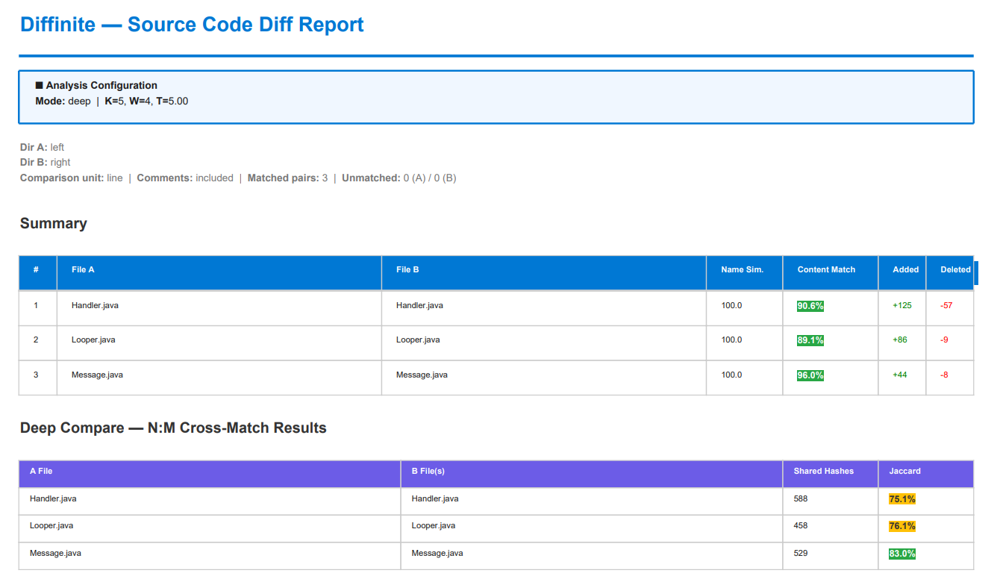
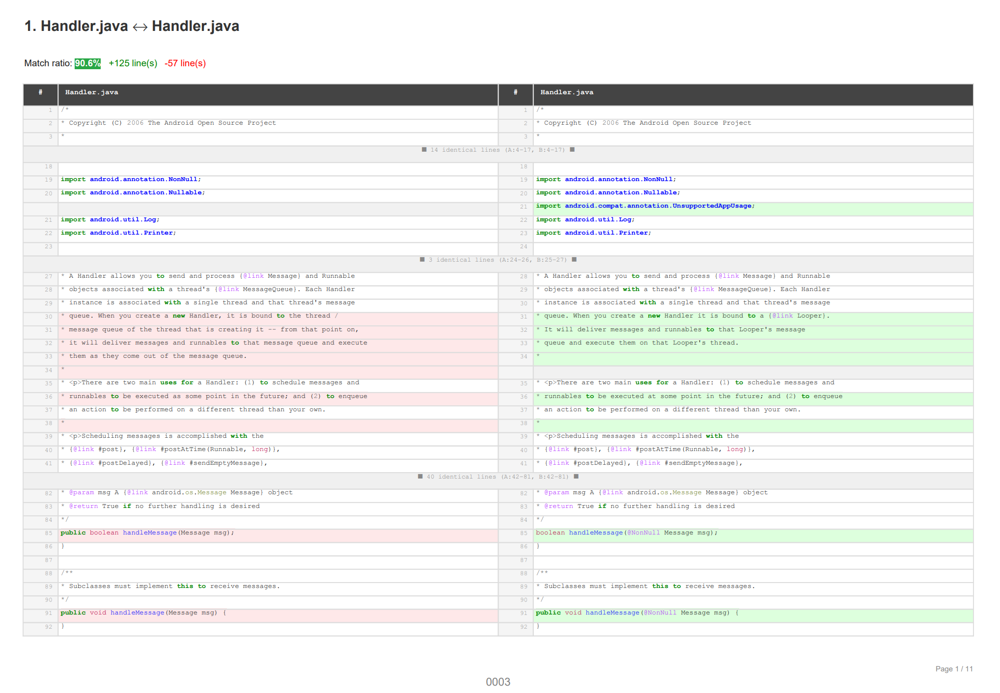

# Diffinite — Source Code Comparison

Forensic source-code comparison tool for **IP litigation and code audit**, available as a VS Code extension with zero-install embedded Python runtime.

Compare two directories of source code with [Winnowing fingerprints](https://theory.stanford.edu/~aiken/publications/papers/sigmod03.pdf) (Schleimer et al., 2003 — the algorithm behind [Stanford MOSS](https://theory.stanford.edu/~aiken/moss/)) and generate professional PDF/HTML/Markdown reports — all from within VS Code.

> **Design Principle**: Diffinite reports **how similar** and **where similar**. It does not classify the type of copying — that is the expert witness's job.





---

## Features

### Core Analysis
- **1:1 File Matching** — Pairs files across two directories using fuzzy name matching, then computes line-by-line or word-by-word diffs with syntax highlighting.
- **N:M Cross-Matching (Deep Mode)** — Winnowing fingerprint-based Jaccard similarity across all file pairs. Detects code reuse across renamed files; for pairs that pass the Jaccard threshold, the directional *A in B / B in A* columns show how much of each file was carried over (Jaccard is diluted when file sizes differ). A small file copied whole into a much larger one can still fall below the Jaccard threshold and not be listed.
- **Comment Stripping** — 6-state FSM parser supporting 45+ file extensions (`.py`, `.js`, `.ts`, `.java`, `.c`, `.cpp`, `.go`, `.rs`, `.swift`, `.rb`, `.php`, `.sql`, `.html`, `.css`, and more).
- **Moved Block Detection** — Detects code blocks that were moved (not just added/deleted) and highlights them in purple (original position) and blue (moved destination).
- **SHA-256 Integrity Hashes** — Every export writes a `<report file>.manifest.sha256.json` listing the SHA-256 of all inputs and outputs. With the **Hash** option (on by default in the GUI), HTML/PDF reports also embed a SHA-256 table of input files (not applicable to Markdown). This is an integrity check: a byte mismatch can be detected only against a copy of the manifest or hashes kept separately. The manifest is not signed, and hashes do not by themselves establish authenticity, chain of custody or admissibility.

### VS Code Integration
- **Real-time Progress Bar** — Pipeline steps and per-worker rendering progress, read from the analyzer's log and stdout.
- **Rough Time Hint** — Counts file sizes upfront (in the background, cancellable, skipping files the exclusion list removes) and shows a rough Simple/Deep duration hint. The hint uses unmeasured rule-of-thumb constants and counts only files with an identical relative path; the Phase 2 hint is rescaled by how long Phase 1 actually took. It is not a measured or calibrated prediction.
- **Large-File Notice** — Shows a non-blocking warning when a same-path file pair is 5 MB or larger; analysis continues. Memory protection itself comes from the CLI's `--max-file-size` (default 10 MB): oversized files are compared by SHA-256 only and left out of Deep Compare; in Deep mode that omission stops the run unless Allow partial analysis is on.
- **Interactive Tree Viewer** — Review matched pairs and choose which files in A to include in the final report. Files in A without a 1:1 pair (Deep Compare cross-file matches, e.g. renamed files, and unmatched files) are listed too; files with a Deep Compare similarity candidate are pre-selected. The report covers each checked file's 1:1 pair and its Deep Compare matches.
- **Reviewed inputs are frozen** — The exclusion list is read once when the analysis starts; the final report and every export use those exact bytes. After the final report is built, the extension checks that the input files' SHA-256 values, the exclusion list and the pairing of the selected files match what you reviewed, and warns if not. An export is published only if its input files still match the results on screen.
- **Exclusion list (`~/.diffignore`)** — If this file exists, its rules are applied to every analysis and export, and the Options panel, review summary and results header say so (rule count and SHA-256). *Edit Dictionary* (Options panel) creates it with every example commented out. A rule without `/` (e.g. `build`) matches that name at any depth; use `/build/` to match only at the top of A and B. Matching is case-sensitive on every OS (`Thumbs.db` and `thumbs.db` need one line each); `!` negation and `\` escapes are not supported. Excluded files are neither compared nor listed as unmatched.
- **Multiple Report Formats** — Export to PDF, HTML, Markdown, or JSON.
- **Forensic Annotations** — Page numbers, file numbers, Bates stamps (with configurable prefix/suffix/start number), filenames on every page.
- **Bates Presets** — Save case-specific Bates configurations as reusable presets in VS Code settings.
- **GUI Options Panel** — Configure all analysis parameters visually without touching the CLI.
- **Embedded Python Runtime** — Windows builds ship with bundled Python 3.12; no separate Python installation required.

---

## Usage

1. Open the Command Palette (`Ctrl+Shift+P` / `Cmd+Shift+P`)
2. Run **"Diffinite: Compare Directories"**
3. Select the original directory (A) and comparison directory (B)
4. Configure options in the GUI panel (mode, thresholds, comment stripping, etc.)
5. Review matched pairs (and files in A without a 1:1 pair) in the interactive tree viewer
6. Export your report (PDF/HTML/Markdown) with one click

---

## How It Works

Diffinite runs a two-stage pipeline:

### Stage 1: 1:1 File Matching (`simple` mode)

1. **Fuzzy name matching** — Pairs files across directories using string similarity (configurable threshold).
2. **Comment stripping** — Optionally removes comments using a 6-state finite state machine parser.
3. **Side-by-side diff** — Computes line-by-line (or word-by-word) diffs using `difflib.SequenceMatcher`.
4. **Report generation** — Renders syntax-highlighted HTML diffs via Pygments, converts to PDF with xhtml2pdf.

### Stage 2: N:M Cross-Matching (`deep` mode, default)

5. **Winnowing fingerprint extraction** — Extracts position-independent code fingerprints (K-gram → rolling hash → window selection).
6. **Inverted index construction** — Builds a hash-to-file mapping for all B-directory fingerprints.
7. **Jaccard similarity computation** — For each A-file, computes `|A∩B| / |A∪B|` against all B-files sharing fingerprints.
8. **Cross-match reporting** — Appends an N:M similarity matrix showing which files from A are similar to which files in B.

---

## Output Report

### Cover Page

Summary table for each matched file pair:

| Column | Description |
|--------|-------------|
| **File A / File B** | Matched file paths |
| **Name Sim.** | Fuzzy filename similarity score (0–100) |
| **Line match (difflib)** (*Word match* under By Word) | `SequenceMatcher.ratio()` — `2 × matched lines ÷ (lines A + lines B)`, shown as a percentage (`100%` = identical). Hash-only pairs (binary or over the size limit) show only whether the SHA-256 hashes are identical. |
| **Added / Deleted** | Lines added to or deleted from File A to produce File B |

### Diff Pages

Side-by-side diff for each matched pair:
- 🟢 **Green** — Lines present only in File B (additions)
- 🔴 **Red** — Lines present only in File A (deletions)
- 🟡 **Yellow** — Lines changed between A and B (word-level diff in `--by-word` mode)
- 🟣 **Purple** — Lines moved from this position (with `--detect-moved`)
- 🔵 **Blue** — Lines moved to this position (with `--detect-moved`)
- No highlight — Identical lines (with configurable context folding)

### Deep Compare Section

N:M cross-matching table (deep mode):

| Column | Description |
|--------|-------------|
| **File A** | Source file from directory A |
| **Matched Files (B)** | All B-files sharing fingerprints above the Jaccard threshold |
| **Shared Hashes** | Count of Winnowing fingerprints the file pair has in common |
| **Jaccard** | `\|A∩B\| / \|A∪B\|` — fraction of shared Winnowing fingerprints |
| **A in B / B in A** | `\|A∩B\| / \|A\|` and `\|A∩B\| / \|B\|` — share of each file's unique fingerprints found in the other — analogous to 원본 기준 / 비교본 기준, but counted in fingerprints, not lines. Stays near 100% when a whole file was copied into a larger one. Descriptive only: rows are selected by the Jaccard threshold. |
| **Inconclusive** | Shown when Normalize is on and the smaller file is below 45 tokens. Outside the measured profile this is a conservative guard, not a calibrated precision claim. |

---

## Extension Settings

| Setting | Default | Description |
|---------|:-------:|-------------|
| `diffinite.pythonPath` | `python` | Path to Python interpreter (ignored when bundled runtime is available) |
| `diffinite.defaultMode` | `deep` | Default execution mode (`simple` or `deep`) |
| `diffinite.workers` | `4` | Number of CPU cores for parallel diff rendering |
| `diffinite.noMerge` | `false` | Save individual reports per file instead of one merged PDF |
| `diffinite.preserveTree` | `true` | Preserve directory tree structure in individual output |
| `diffinite.pdfLang` | `ko` | Language for CJK font resolution in PDF output (`ko`, `ja`, `zh-cn`, `en`). Auto-resolves the best OS-installed font. |
| `diffinite.pdfFont` | (empty) | Absolute path to a `.ttf`/`.otf` font to embed in the PDF. Overrides `pdfLang`. Leave empty to use built-in CJK fonts. |
| `diffinite.batesPresets` | `[]` | Saved Bates presets (prefix/suffix/start number per case) |

> **CJK / Unicode**: Korean, Japanese, and Chinese source code renders correctly in PDF and HTML reports. The `pdfLang` setting (default `ko`) picks an appropriate OS font for PDF output; HTML uses the browser's native font fallback.

```json
{
  "diffinite.batesPresets": [
    { "name": "Oracle v. Google", "prefix": "GOOG-", "suffix": "-HIGHLY_CONF", "nextBatesNumber": 1 },
    { "name": "Internal Audit Q1", "prefix": "AUDIT-", "suffix": "" }
  ]
}
```

### GUI Options Panel

All options are configurable through the built-in GUI panel. Defaults below are the GUI defaults (`defaultAnalysisOptions`); where a CLI default differs, it is noted.

| Option | Default | Description |
|--------|:-------:|-------------|
| **Mode** | `deep` | `simple` = 1:1 only. `deep` = 1:1 + N:M cross-matching |
| **Strip Comments** | off | Remove comments before comparison |
| **By Word** | off | Compare by word instead of by line |
| **Normalize** | off | Normalize identifiers → `ID`, literals → `LIT` before fingerprinting. Python records the effective threshold and whether the measured profile (K=5, W=4, comments stripped, language-aware off) applies. Other profiles are shown as unvalidated; matches below 45 tokens remain *inconclusive / 판단 유보*. |
| **Collapse Identical** | off | Fold unchanged blocks (3 context lines) |
| **Detect Moved Blocks** | off | Highlight moved code in purple/blue instead of plain delete/add |
| **No Autojunk** | **on** | Disables the difflib autojunk heuristic. The CLI default is autojunk *enabled*, so line ratios can differ from a default CLI run; the value used is recorded in report metadata. |
| **Hash (SHA-256)** | **on** | Embed a SHA-256 table of input files in HTML/PDF reports (CLI default: off). The manifest is written either way. Integrity check only, not a signature or chain-of-custody proof. |
| **Page / File / Bates Numbers** | **on** | Stamp page numbers, file numbers and Bates numbers on PDF pages (CLI defaults: off). |
| **Encoding** | `auto` | Force file encoding (`euc-kr`, `utf-8`, etc.) or auto-detect |
| **Uncompared Mode** | `inline` | How unmatched files appear: `inline`, `separate`, or `none` |
| **Threshold** | `60` | Fuzzy file-name matching threshold (0–100) |
| **Language-aware fingerprints** | — | Not exposed here: `--lang-aware` is available from the CLI only. |
| **K-gram** | `5` | Winnowing K-gram size. K=5 is the value frozen in the measured calibration profile; the paper prescribes no k for source code (Schleimer 2003, §5). |
| **Window** | `4` | Winnowing window size. Shared runs of ≥ K+W−1 tokens always share at least one fingerprint; whether the pair is listed depends on the Deep threshold. |
| **Deep Threshold Mode** | `Auto` | Auto omits `--threshold-deep`, so Python remains the source of truth. Manual passes only the value explicitly entered by the user and is shown with `user` provenance. |
| **Allow Partial** | off | Permit an explicitly **Incomplete analysis / 불완전 결과** after a worker or file failure. Off is fail-closed. |
| **Bates Preset** | — | Select a saved preset to auto-fill prefix/suffix/start |
| **Bates Prefix** | (empty) | Prefix for Bates numbering (e.g. `PLAINTIFF-`). Prefix and suffix may use Windows-1252 Latin characters, or Hangul with ASCII; the panel refuses anything else, because the stamp cannot draw it. |
| **Bates Suffix** | (empty) | Suffix for Bates numbering (e.g. `-CONFIDENTIAL`) |
| **Starting Number** | `1` | First Bates number. A preset pre-fills it from `nextBatesNumber`; it is **not** updated after export, so set the next unused number before each export to avoid reusing a Bates range. |

Older saved options have no Auto/Manual marker, so an existing numeric
`thresholdDeep` cannot be distinguished from an intentional override. Migration
preserves that number as **Manual** and displays a warning; selecting Auto is an
explicit user choice. Result JSON schema v2 displays Python's effective threshold,
provenance, canonical calibration disclosure, actual preprocessing, and
partial/truncation status. Legacy JSON still opens with missing fields shown as
`unknown`, rather than being inferred as complete or calibrated.

---

## Requirements

This extension ships with an **embedded Python 3.12 runtime** on Windows — no separate installation required.

For Mac/Linux, Python ≥ 3.10 with diffinite is required:
```bash
pip install diffinite
```

---

## Comment Stripping Support

The **Strip Comments** option removes comments using a 6-state FSM parser covering 45+ file extensions:

| Extensions | Comment Styles |
|------------|---------------|
| `.py`, `.pyw` | `# line` (docstrings preserved) |
| `.js`, `.jsx`, `.mjs`, `.ts`, `.tsx` | `// line`, `/* block */`, template literals, regex literals |
| `.java`, `.kt`, `.kts`, `.scala`, `.c`, `.cc`, `.cpp`, `.h`, `.hpp`, `.cs`, `.go`, `.rs`, `.swift` | `// line`, `/* block */` |
| `.html`, `.htm`, `.xml`, `.svg` | `<!-- block -->` |
| `.css`, `.scss`, `.less` | `/* block */` |
| `.sql`, `.ddl`, `.dml`, `.pks`, `.pkb`, `.plsql`, `.tsql` | `-- line`, `/* block */` |
| `.php` | `// line`, `# line`, `/* block */` |
| `.rb` | `# line`, `=begin … =end` block |
| `.pl`, `.pm`, `.sh`, `.bash`, `.zsh`, `.r`, `.yaml`, `.yml`, `.toml` | `# line` |
| `.lua` | `-- line`, `--[[ block ]]` |

---

> 📊 Benchmark results and dataset rationale → [see GitHub README](https://github.com/nash-dir/diffinite#benchmarks)

---

## Limitations

- **General-purpose tokenizer** — Uses a single regex tokenizer, not language-specific parsers.
- **Position-independent** — Reordered functions may produce higher similarity than expected.
- **No corpus-wide weighting** — Pairwise comparison only; no TF-IDF to down-weight common idioms.
- **Not a legal opinion** — Similarity scores are mathematical measurements, not legal conclusions.

---

## License

[Apache License 2.0](https://github.com/nash-dir/diffinite/blob/master/LICENSE)

See [NOTICE](https://github.com/nash-dir/diffinite/blob/master/NOTICE) for attribution.
